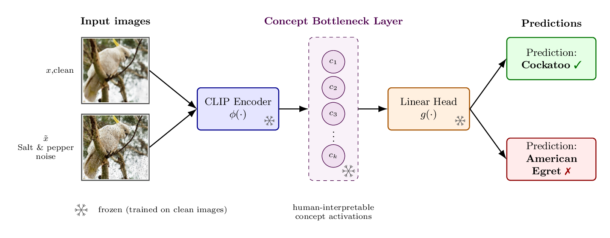
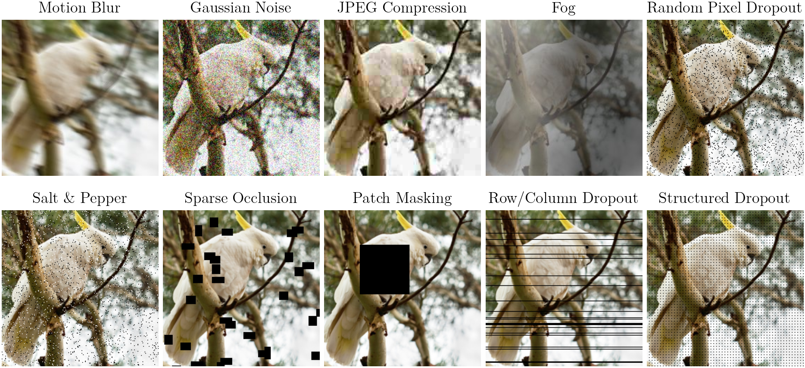

# Concept Bottleneck Models in the Wild: Assessing Interpretability under Image Corruptions

Paper on **[arXiv](https://arxiv.org/abs/XXXX.XXXXX)** (link coming soon).

**Accepted at the Trustworthy AI for Good and the Self-Evolving Diversity-Driven Search for Robust AI Systems workshops, NeurIPS 2026.**

Authors: Kexin Zhang, Katharina Prasse, Mishal Fatima, Margret Keuper (University of Mannheim)



## Overview

Concept Bottleneck Models (CBMs) route every prediction through named, human-auditable
concepts. Deployed, they face sensor noise, blur, weather and dead pixels, yet CBMs have so
far been evaluated on clean data only. We follow ten image corruptions through three CBMs
(DCBM, Label-free CBM, Post-hoc CBM) on a frozen CLIP ViT-B/16 and find:

- **Corruption hurts all three CBMs.** Accuracy drops by 4–66 points, depending on corruption type and severity; Gaussian noise is harshest, patch masking mildest.
- **Corruption reorders concepts.** The CLIP embedding direction is largely preserved (cosine $\geq 0.59$), yet the concept activation vector is reordered with the top-1 activated concept changes in 70–100% of images.
- **Concepts differ in robustness, and the robust ones can be found.** A per-concept shift score $d_k$ ranks concepts consistently across corruptions. Pruning the unstable ones and retraining each head with its own deployed recipe raises corrupted accuracy above the deployed full-bank model by 0.5–1.1 points for all three CBMs while dropping 13–41% of the concepts, at a clean cost of at most 0.5 points. A size-matched random subset never beats the deployed model.


*Four natural corruptions from ImageNet-C and six sensor corruptions, at severity 3.*

## Setup

```bash
git clone --recursive https://github.com/kexinkk/cbm-in-the-wild.git
cd cbm-in-the-wild
conda create -n cbm-wild python=3.11 -y && conda activate cbm-wild
pip install torch==2.1.2 torchvision==0.16.2 --index-url https://download.pytorch.org/whl/cu121
pip install -e . git+https://github.com/openai/CLIP.git
export DCBM_REPO=$PWD/third_party/DCBM LFCBM_REPO=$PWD/third_party/Label-free-CBM
```

Datasets are read from `./data` (override with `DCBM_DATA_DIR`): ImageNet-1k and CIFAR-10 as
image folders, and the distributed [ImageNet-C / CIFAR-10-C](https://github.com/hendrycks/robustness)
files for motion blur, Gaussian noise, JPEG compression and fog. The six sensor corruptions are
generated on the fly (`src/cbm_in_the_wild/corruptions/sensor_c.py`); run corruption jobs with
`PYTHONHASHSEED=0` so their per-image masks match ours. Rebuilding the DCBM concept bank also
needs [SAM2](https://github.com/facebookresearch/sam2), installed from `third_party/DCBM`.

## Checkpoints

```bash
bash scripts/download_checkpoints.sh   # ~30 MB from the GitHub release, unpacked in place
```

| Model (CLIP ViT-B/16) | Concepts | ImageNet clean top-1 accuracy (%) |
|---|---|---|
| DCBM | 2048 SAM2-crop medoids | 69.77 |
| Label-free CBM | 4589 text concepts | 75.48 |
| Post-hoc CBM | 4589 text concepts | 72.04 |

CIFAR-10 models are included. For DCBM we release the concept embeddings and crop ids, not the
crops themselves, which are pieces of ImageNet images.

## Running

Each directory under `experiments/` holds the runner, its `config.yaml` and our result files.

| Paper | Experiment | Entry point |
|---|---|---|
| DCBM reproduction | `imagenet_baseline` | `scripts/data_prep/imagenet_*` (bank), then `run.py` |
| Corruption calibration | `corruption_baselines` | `run.py --dataset imagenet` |
| Stage-wise propagation | `imagenet_c_propagation`, `imagenet_{lfcbm,pcbm}_genericity` | `run_cell.py --task-id 0..49`, `run_propagation.py` |
| Per-concept shift $d_k$ | `imagenet_concept_shift_robust_set`, `imagenet_{lfcbm,pcbm}_genericity` | `run.py`, `run_concept_shift.py` |
| Concept selection, head retrained (Section 4) | `imagenet_pruned_bank_deployed_retrain` (DCBM), `imagenet_pruned_concepts_family_retrain` (LF-CBM, PCBM) | `run.py` |
| Concept selection, common $L_2$ refit (Appendix) | `imagenet_concept_shift_robust_set`, `imagenet_{lfcbm,pcbm}_genericity` | `ablation_capacity_matched.py`, `run_ablation.py` |
| $d_k$ on a disjoint pool, unseen corruptions | `imagenet_dk_disjoint_pool` | `embed_train_pool.py`, `compute_dk.py`, then the retrain `dkd<K>` / `loco_<c>_<K>` arms and `aggregate_loco_retrain.py` |
| Crop geometry | `imagenet_crop_quality_dk` | `run.py`, `run_causal.py`; retrain arms `geom<K>`, `dkres<K>` |

The retrain runners are resumable: each call trains until a wall budget (`TRAIN_DEADLINE`
for DCBM, `TIME_BUDGET_S` for LF-CBM/PCBM), and rerunning the same command continues.

```bash
python experiments/imagenet_pruned_bank_deployed_retrain/run.py --phase train --arm dk1200 --seed 0
python experiments/imagenet_pruned_bank_deployed_retrain/run.py --phase eval        # then --phase summarize
python experiments/imagenet_pruned_concepts_family_retrain/run.py --family lfcbm --arm dk3600 --seed 0
python experiments/imagenet_pruned_concepts_family_retrain/run.py --summarize
```

The DCBM `native<K>` arms reuse the K-means banks cached by `ablation_capacity_matched.py`.

CIFAR-10 counterparts are in the `cifar10_*` directories. LF-CBM and PCBM are trained with
`train_lfcbm.py` / `train_pcbm.py --bank mmL` in their experiment directories.

## Citation

```bibtex
@article{zhang2026cbmwild,
  title   = {Concept Bottleneck Models in the Wild: Assessing Interpretability under Image Corruptions},
  author  = {Zhang, Kexin and Prasse, Katharina and Fatima, Mishal and Keuper, Margret},
  journal = {arXiv preprint arXiv:XXXX.XXXXX},
  year    = {2026}
}
```

## Acknowledgements

This code builds on [DCBM](https://github.com/KathPra/DCBM),
[Label-free CBM](https://github.com/Trustworthy-ML-Lab/Label-free-CBM),
[Post-hoc CBM](https://github.com/mertyg/post-hoc-cbm) (all in `third_party/`),
[CLIP](https://github.com/openai/CLIP), [SAM2](https://github.com/facebookresearch/sam2) and
[ImageNet-C](https://github.com/hendrycks/robustness). Released under the MIT license.
